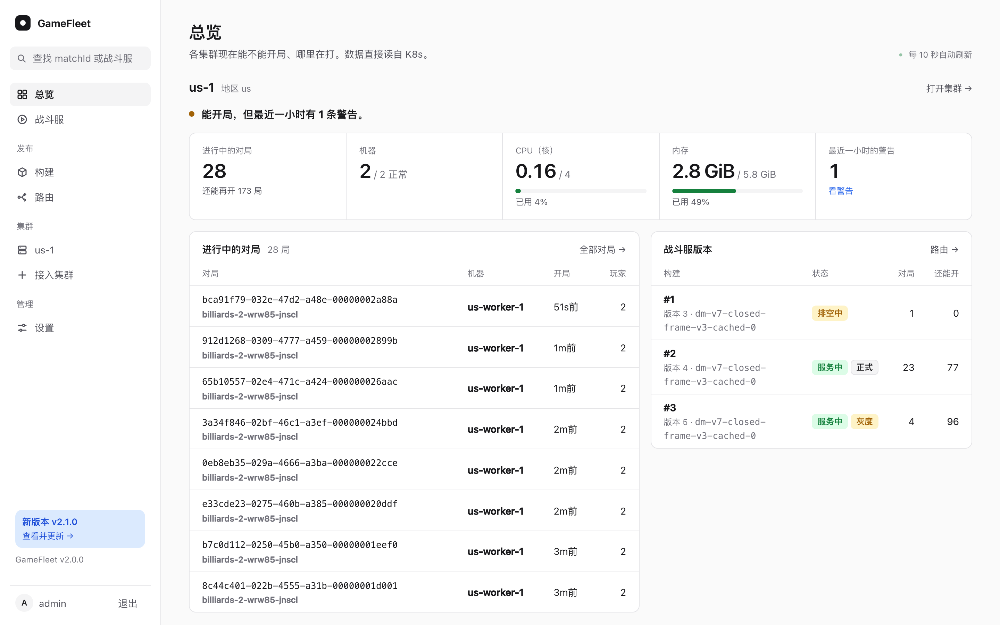

# GameFleet

GameFleet runs dedicated game servers on machines you rent yourself. It turns
a few VPSes into K3s and Agones clusters, keeps a registry for your game server
images, releases builds with canary and rollback, and gives your matchmaker one
API call to get a game server for a match. Its console and docs are in Chinese.

GameFleet 用你自己租的 VPS 跑战斗服（专用游戏服务器）：把几台机器装成 K3s 和 Agones 集群，存放战斗服镜像，按构建发版、上灰度、回滚，并给你的匹配服务一个接口，为每一局分配一个战斗服。



## 它做什么

- **集群和机器：** 在控制台里填一台新 VPS 的 IP 和 root 密码，GameFleet 登录上去装好 K3s 和 Agones，接成一个地区的集群；同一地区扩容就再加机器，退掉机器前先在控制台里让它下线。
- **镜像和构建：** 内置一个镜像仓库。CI 用 API key 推镜像、登记构建，GameFleet 从镜像标签里读出联机版本等信息。
- **发版：** 每个构建在每个集群里是一个独立的 Agones Fleet。路由决定新对局进哪个构建：按联机版本分，正式和灰度两个通道。上灰度、晋升、回滚都只是改一下路由；不同联机版本的客户端可以同时在线，各进各的构建。
- **分配：** 匹配服务配好一局后，调用一次接口，GameFleet 在这个地区找一个还有空位的战斗服。一个战斗服进程同时跑多局。
- **控制台：** 每个集群有哪些机器、资源用了多少、哪个战斗服在跑哪几局、日志和事件；发版、加机器、管理 key 和运行时配置；所有改动都记进审计日志。
- **在线更新：** 有新版本时控制台左下角会提示，点开能看更新说明，下载完点一下就重启到新版本。

## 它不做什么

- **不管玩家。** 账号、匹配、谁是测试玩家，都由你的游戏后端决定。GameFleet 只收一局的 matchId 和玩家列表，原样写到战斗服上。
- **不做高可用。** GameFleet 和镜像仓库在一台管理机上。它停了，正在打的对局不受影响；新的对局要等它回来才分得到战斗服。更新时它只停几秒，匹配服务按 matchId 重试的话，玩家只是多等一会儿，见[接口](docs/api.md#gamefleet-重启的时候)。
- **不管游戏本身怎么跑。** 战斗服用什么引擎、怎么验证玩家，见[战斗服约定](docs/game-server.md)。

## 必需的和可选的

接入一个游戏，必须做的只有三件事：CI 推镜像并登记构建，匹配服务调用分配接口，战斗服遵守[约定](docs/game-server.md)（加载完调 `Ready()`，按 `rooms` 开局和收尾）。其他功能都是可选的，不用就不配：

| 功能 | 不用的时候 |
|---|---|
| 灰度 | 只设正式路由，匹配服务都传 `stable` |
| 多个地区 | 只接一个集群 |
| 运行时配置 | 不填，战斗服照常启动 |
| 结束一局、删除战斗服（`gm` 权限） | 不建这种 key；战斗服也不用处理结束请求 |
| 在控制台里更新 | 没有 systemd 的机器不装更新器，用安装脚本升级 |

## 架构

```
            CI ──推镜像、登记构建──┐
                                 ▼
  你的匹配服务 ──分配战斗服──▶ GameFleet（管理机：控制台、API、镜像仓库）
                                 │ K8s API
                 ┌───────────────┴───────────────┐
                 ▼                               ▼
          集群 us-1（K3s + Agones）        集群 sg-1（K3s + Agones）
          战斗服 ◀── 玩家直连 UDP          战斗服 ◀── 玩家直连 UDP
```

每个地区一个集群。玩家只连战斗服，不经过 GameFleet。

## 快速开始

需要：一台 2 核 4 GB 的 VPS 做管理机（Debian 或 Ubuntu，x86_64），一个解析到它的域名，云防火墙放行 TCP 80、443。

1. **安装。** 在管理机上用 root 执行：

   ```sh
   curl -fsSL https://github.com/xuhuanhello/gamefleet/releases/latest/download/install.sh |
     sh -s -- --domain fleet.example.com --email 你的邮箱
   ```

   脚本装好 Docker、GameFleet、镜像仓库和 HTTPS，建一个控制台账号 `admin`，大约 3 分钟。

2. **登录。** 密码和验证器链接只在管理机上，在你自己的终端里取：

   ```sh
   ssh root@管理机 cat /opt/gamefleet/credentials/console-password
   ssh root@管理机 cat /opt/gamefleet/credentials/console-otpauth | qrencode -t ansiutf8
   ```

   用验证器 App 扫二维码，打开 `https://fleet.example.com`，填用户名、密码和 6 位验证码。

3. **接入集群。** 点"接入集群"，填一台新 VPS 的 IP 和 root 密码。几分钟后它就是一个集群。见[集群和机器](docs/clusters.md)。

4. **推第一个构建。** 在"设置 → API key"里建一把 `push` 权限的 key，CI 用它推镜像、登记构建。见[构建、部署和路由](docs/releases.md)。

5. **部署和路由。** 在构建页把构建部署到集群，再"设为正式"。

6. **分配战斗服。** 你的匹配服务用一把 `allocate` 权限的 key 调用 `POST /api/v1/allocations`，见[接口](docs/api.md)。

## 文档

- [安装、升级和备份](docs/install.md)
- [集群和机器](docs/clusters.md)
- [构建、部署和路由](docs/releases.md)
- [战斗服约定](docs/game-server.md)：镜像标签、Agones 上的房间表、一局的开始和结束
- [接口、命令行和配置](docs/api.md)

## 开发

```sh
go test ./...
go run ./cmd/console-preview    # 用编造的数据在 http://127.0.0.1:8091 打开控制台，已经登录
go run ./cmd/console-preview -update latest   # 更新页的其他状态：available、downloaded、apply-failed……
go build -o bin/gamefleet ./cmd/gamefleet
```

GameFleet 只监听 HTTP，放在 Caddy 后面，由 Caddy 负责 HTTPS。管理机上跑的文件在 [`deploy/`](deploy/)。

| 目录 | 内容 |
|---|---|
| `cmd/gamefleet` | 服务本身，以及 `user`、`key`、`var`、`cluster add` 命令 |
| `cmd/console-preview` | 用编造的数据打开控制台，看页面、截图用 |
| `internal/cluster` | 对一个集群的全部读写；`clustertest` 是测试用的假集群 |
| `internal/clusters` | 接入集群、加机器、下线机器、运行时配置 |
| `internal/remote` | 通过 SSH 在一台机器上执行安装命令 |
| `internal/install` | 新机器执行的脚本：`cluster.sh`、`node.sh`、`rbac.yaml` |
| `internal/release` | 构建、部署、路由，以及让集群符合它们的后台循环 |
| `internal/allocate`、`internal/api` | 给机器调用的接口 |
| `internal/registry` | 镜像仓库前面的一层：检查 key、读镜像标签 |
| `internal/update` | 检查新版本、和管理机上的更新器打交道 |
| `internal/auth` | 控制台登录、TOTP 和 API key |
| `internal/web` | 控制台 |
| `internal/store` | SQLite 数据库 |

发版：打一个带说明的 tag，GitHub Actions 发布镜像和 Release。说明就是 tag 的注释：

```sh
git tag -a v2.1.0 -m "说明……" && git push origin v2.1.0
```

## 许可

[MIT](LICENSE)
