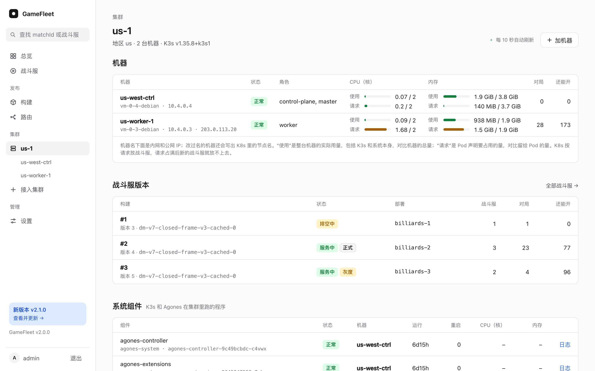

# 集群和机器

一个集群服务一个地区，比如 `us-1` 服务玩家选的地区 `us`。同一地区要扩容，就给集群加机器；要开新地区，就接入一个新集群。

下面的操作都在控制台里做。GameFleet 用你填的 root 密码或私钥登录那台机器执行安装；密码和私钥只留在 GameFleet 的内存里，安装完、过了一小时或者 GameFleet 重启就丢掉，不写进数据库和日志。不想把密码交给 GameFleet，每个页面都有"只要命令，我自己执行"，在那台机器上用 root 执行同样的命令即可。

新机器的 SSH 主机指纹没法事先核对，GameFleet 把它显示在页面上和审计日志里，可以和云服务商控制台里显示的对照。

## 接入一个新集群

**准备一台 VPS 做集群的第一台机器：**

- Debian 或 Ubuntu，x86_64，刚重装过，设好 root 密码；
- 云防火墙对管理机放行 TCP 22 和 6443：22 用来登录安装，装完可以关掉；6443 是 GameFleet 管理这个集群的入口，只对管理机放行；
- 云防火墙对所有地址放行 UDP 20000-20999，玩家从这里连战斗服。

**步骤：**

1. 在控制台点左侧的"接入集群"。
2. 集群名按"地区-序号"起，比如 `jp-1`；地区填玩家在客户端里选的地区代码，比如 `jp`。
3. 填机器 IP 和 root 密码，点"开始安装"。
4. 页面显示进度：登录机器、装 K3s、装 Agones、GameFleet 连接集群。3 到 5 分钟后完成，新集群出现在左侧导航里。

**只做控制面：** 如果这台机器同时跑着别的东西（比如管理机自己），勾上"这台机器只做控制面"，它只管理集群，不跑战斗服；战斗服跑在之后加的机器上。

**加入码一小时内有效。** 超过一小时没装完，重新点"接入集群"生成一个。



接好以后，把要上线的构建部署到新集群，这个地区的玩家就能匹配了，见[构建、部署和路由](releases.md)。

## 给集群加机器

新机器的要求和上面一样，另外要能连到集群控制面的 TCP 6443：同一内网的机器走内网；控制面在公网时，要在控制面的云防火墙里对新机器放行 6443。

1. 打开集群页，点右上角的"加机器"。
2. 填机器 IP、root 密码，名称可以不填。点"开始加入"。
3. 页面显示进度和安装日志。两三分钟后机器出现在集群页，Agones 开始在上面放战斗服。

失败时，页面上写着停在哪一步、为什么，日志里有详细输出。改好原因（多半是防火墙）后点"重试"，不用重新填密码。

## 给机器改名

K8s 里的节点名来自主机名，加入后改不了。控制台可以另给机器起一个名称：在机器页的"机器信息"里改。名称只在控制台里显示。

## 下线一台机器

用在退掉机器、或者要重装系统之前。

1. 打开机器页，点右上角的"下线这台机器"，确认。
2. GameFleet 不再往它上面放新的战斗服，它上面的战斗服都不再接新的对局。没有对局的战斗服在下一轮（约 15 秒后）删掉，Fleet 会在别的机器上补齐。先停接新局、再删，是为了不删掉一个刚分到对局的战斗服。
3. 正在打的对局照常打完。机器上的对局都打完后，GameFleet 把它从集群里删掉。

删掉以前可以随时点"取消下线"。后台正好在删这台机器时，"取消下线"会等它这一轮做完：机器还在就取消成功，已经删掉了就提示机器不在了。删掉以后，在那台机器上执行 `k3s-agent-uninstall.sh`，或者直接重装系统。控制面不能下线。

## 管理机重装以后

新的 GameFleet 不认识原来的集群。对每个集群，按"接入一个新集群"再接一次，集群名和地区填原来的。安装脚本发现 K3s 和 Agones 已经装好，只补上缺的部分，再把连接信息交给新的 GameFleet。

旧 GameFleet 留在集群里的部署，新 GameFleet 不认识：它们不再补空闲的战斗服，上面的对局打完后整个删掉。要接着服务玩家，就把构建重新部署到这个集群。

## 更新集群上的权限和 Agones 设置

接入集群时，安装脚本在集群控制面上写了两个文件，K3s 会应用它们，文件一变就重新应用：

- `/var/lib/rancher/k3s/server/manifests/gamefleet.yaml`：GameFleet 在集群里的账号和权限；
- `/var/lib/rancher/k3s/server/manifests/agones.yaml`：Agones 的安装参数。

新版本的 GameFleet 改了其中一个时，更新说明里会写，要在每个集群的控制面上更新。权限文件和 GameFleet 提供的那份一样，直接下载覆盖：

```sh
curl -sf https://fleet.example.com/install/rbac.yaml -o /var/lib/rancher/k3s/server/manifests/gamefleet.yaml
```

Agones 的参数照着本仓库 `internal/install/cluster.sh` 里写 `agones.yaml` 的那一段改。改完后 K3s 重装 Agones，十几秒里分配不了战斗服；正在打的对局不受影响。只用 `kubectl apply` 也能马上生效，但 K3s 重启时会按这两个文件改回去，所以要改文件。

## GameFleet 在集群里能做什么

GameFleet 用每个集群里的账号 `agones-games/gamefleet` 操作集群，权限在 [`internal/install/rbac.yaml`](../internal/install/rbac.yaml)：

- 在 `agones-games` 命名空间里：分配、读取、标记、删除战斗服；创建、缩放、删除 Fleet 和它的自动扩缩器；写 Secret，但读不了；
- 整个集群范围：读节点、Pod、日志、事件和资源用量；给节点打标记、删除节点（下线机器用）。

GameFleet 在每个集群里写两种 Secret：`gamefleet-registry`（拉镜像的 key）和 `<游戏>-runtime`（运行时配置）。

## 版本

| 组件 | 版本 |
|---|---|
| K3s | v1.35.8+k3s1 |
| Agones | 1.60.0 |
| 战斗服端口段 | UDP 20000-20999 |

新接入的集群和新加的机器都装这个版本。已经在跑的集群不会自动升级。
