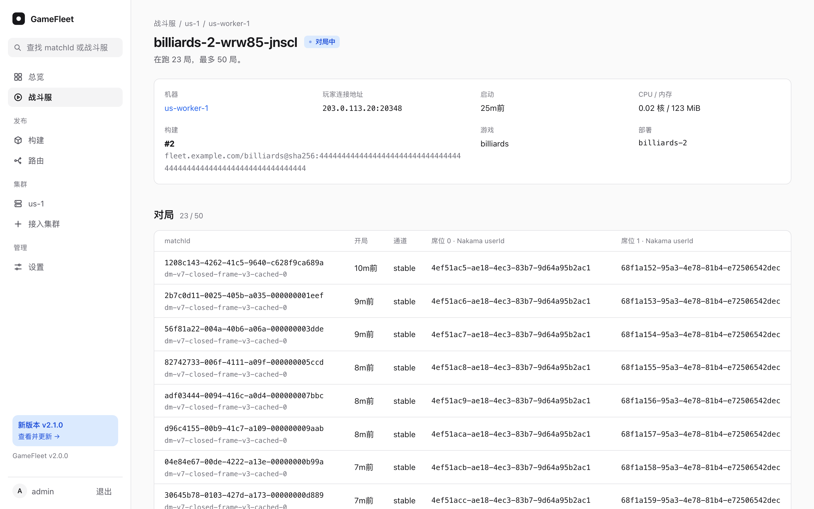

# 战斗服约定

战斗服是你的游戏服务端，打成镜像后由 Agones 运行，一个进程可以同时跑多局，最多几局在部署里设；一局一个进程的游戏设成 1。用什么引擎都可以，只要遵守下面的约定。它通过 [Agones SDK](https://agones.dev/site/docs/guides/client-sdks/) 和集群打交道，和 GameFleet 没有直接往来。

## 镜像

| 标签 | 必填 | 用途 |
|---|---|---|
| `io.gamefleet.compat` | 是 | 联机版本。GameFleet 按它找路由：客户端只能进联机版本相同的战斗服 |
| `org.opencontainers.image.revision` | 是 | 源码 commit |
| `org.opencontainers.image.version` | 是 | 版本，控制台里显示为"版本" |

- 镜像必须 `EXPOSE` 正好一个端口，比如 `7770/udp`。Agones 在 20000-20999 里给每个战斗服分一个公网端口，转到这个端口。
- 镜像里不要放密钥。运行时需要的设置放在 GameFleet 的运行时配置里，战斗服启动时从环境变量读到，见[运行时配置](releases.md#运行时配置)。

## 一局的开始和结束

```
战斗服启动 ── Ready() ──▶ 空闲
                           │ GameFleet 分配一局：rooms 里多一个 matchId，加一条注解
                           ▼
              Watch 到新的 matchId ──▶ 开一个房间，等玩家连进来
                           │ ……打完
                           ▼
              结果交给你的游戏后端 ──▶ 从 rooms 里删掉这个 matchId，空出位置
```

1. **启动：** 加载完成后调用 SDK 的 `Ready()`。之后它是一个"空闲"的战斗服。最多跑几局由 GameFleet 在分配时把关，战斗服不用知道；列表 `rooms` 的容量是 GameFleet 允许的最大值 80，不是部署设的局数。
2. **分到一局：** 你的匹配服务调用 GameFleet 的分配接口后，Agones 把 matchId 加进某个战斗服的 `rooms`，GameFleet 同时写一条注解 `gamefleet.io/match.<matchId>`。战斗服用 SDK 的 `WatchGameServer` 看到新的注解，就为这一局开一个房间。注解的内容：

   ```json
   {"players": [{"userId": "u-1", "seat": 0}, {"userId": "u-2", "seat": 1}],
    "channel": "stable", "compat": "dm-v7", "allocated": "2026-10-23T12:00:00Z"}
   ```

   `players` 原样来自你的匹配服务，GameFleet 不解读。
3. **玩家连进来：** 玩家连分配接口返回的 `address:port`。怎么确认来的是这一局的玩家（比如校验你的游戏后端签发的票据），是你的游戏的事。
4. **结束：** 一局打完，先把结果交给你的游戏后端，**交出去以后**再用 SDK 的 `DeleteListValue("rooms", matchId)` 把它删掉。这样结果还没交出去时，GameFleet 按 matchId 查这一局仍然查得到。
5. **战斗服自己不退出。** `rooms` 空了也留着，接下一局。

**GameFleet 什么时候删战斗服：** 只删一局都没有的战斗服：部署排空时、所在机器下线时，以及已经 5 分钟没分到新对局、空闲战斗服又多余时。有对局的战斗服会先被打上标签 `gamefleet.io/retiring`，不再分到新的对局，打完再删。

控制台的战斗服页能看到每个战斗服在跑哪几局、谁在打，以及它的日志：



**一个战斗服崩溃，上面的对局都没了。** 部署的"每个战斗服最多几局"决定一次最多影响几局。

## 被要求结束一局

GM 工具可以调用 GameFleet 的 `POST /api/v1/matches/{matchId}/end`，提前结束一局。GameFleet 给跑这一局的战斗服加注解 `gamefleet.io/end.<matchId>`，值是要求的时间。战斗服看到后：

1. 关掉这一局的房间，告诉玩家；
2. 按"这局作废"把结果交给你的游戏后端；
3. 和正常结束一样，从 `rooms` 里删掉 matchId。

这一节是可选的。不处理这条注解的战斗服，结束请求不起作用：接口照样返回 `202`，这一局照常打完。要强制结束，只能用 `DELETE /api/v1/rooms/{名字}` 删掉整个战斗服，上面的对局都会没了。

## GameFleet 写在 GameServer 上的信息

| 键 | 类型 | 内容 |
|---|---|---|
| `rooms` | Agones 列表 | 正在跑的对局的 matchId。容量固定是 80，部署设的局数不在这里 |
| `gamefleet.io/match.<matchId>` | 注解 | 这一局的玩家、通道、联机版本和分配时间。对局从 `rooms` 里删掉以后，GameFleet 在 15 秒内清掉它 |
| `gamefleet.io/end.<matchId>` | 注解 | 要求结束这一局的时间，和上一项一起清掉 |
| `gamefleet.io/game` | 标签 | 游戏名 |
| `gamefleet.io/retiring` | 标签 | 有它就不再分新的对局 |

## 资源

部署时设置每个战斗服的 CPU、内存的申请量和上限。K8s 按申请量决定一台机器放得下几个战斗服：一台机器的申请量占满后，新的战斗服就放不上去，会一直停在"启动中"。

作为参考：一个用 Unity 做的台球战斗服，空闲时约 115 MiB 内存、22m CPU，每多一局约多 1 MiB、1.5m CPU。
