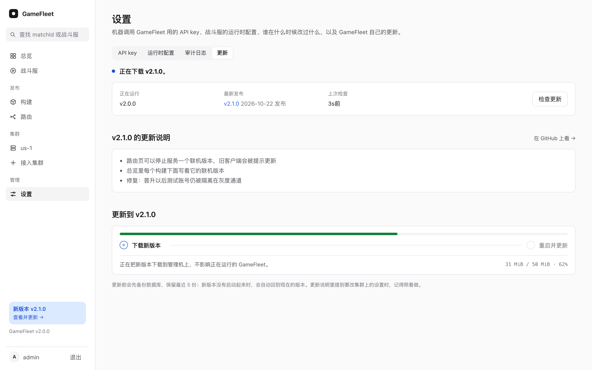

# 安装、升级和备份

## 准备

- **管理机：** 一台 VPS，2 核 4 GB 够用，Debian 或 Ubuntu，x86_64，有 root。GameFleet、镜像仓库和 Caddy 都跑在这台上。
- **域名：** 一个解析到管理机的域名，比如 `fleet.example.com`。控制台、API、镜像仓库都在这个域名下，Caddy 自动申请 HTTPS 证书。
- **防火墙：** 管理机对所有地址放行 TCP 80（申请证书）和 443。

集群的机器另外准备，见[集群和机器](clusters.md)。

## 安装

在管理机上用 root 执行：

```sh
curl -fsSL https://github.com/xuhuanhello/gamefleet/releases/latest/download/install.sh |
  sh -s -- --domain fleet.example.com --email 你的邮箱
```

`--email` 是申请证书时留给证书机构的联系邮箱。脚本依次：

1. 把这个版本的部署文件下载到 `/opt/gamefleet`；
2. 没有 Docker 就装上；拉 GameFleet 的镜像；
3. 装更新器（systemd 服务 `gamefleet-updater`），控制台里的在线更新靠它；
4. 第一次运行时建控制台账号 `admin`：随机密码写进 `credentials/console-password`，验证器链接写进 `credentials/console-otpauth`；
5. 启动 Caddy、GameFleet 和镜像仓库，等 `https://域名/healthz` 报出这个版本号，最多 3 分钟。

重复运行是安全的：账号、数据和密钥都保留，没运行的重新运行起来。想用自己编译的镜像，加 `--image 镜像`。

## 登录

在你自己的终端里取出密码，存进密码管理器；把验证器链接加进验证器 App：

```sh
ssh root@管理机 cat /opt/gamefleet/credentials/console-password
ssh root@管理机 cat /opt/gamefleet/credentials/console-otpauth | qrencode -t ansiutf8
```

打开 `https://fleet.example.com`，填用户名 `admin`、密码和 App 上的验证码。验证码每 30 秒换一次，每个只能用一次。登录一次管 12 小时；登录状态在内存里，GameFleet 重启后要重新登录。

能登录以后，就可以删掉管理机上的这两个文件：`rm /opt/gamefleet/credentials/console-password /opt/gamefleet/credentials/console-otpauth`。

**加账号、重设密码：** 账号写在 `/opt/gamefleet/private/config.json` 的 `users` 里。生成一条新账号（密码从标准输入读，验证器链接写进文件）：

```sh
cd /opt/gamefleet
docker run --rm -i --user 0:0 -v "$PWD/credentials:/out" "$(sed -n 's/^GAMEFLEET_IMAGE=//p' .env)" \
  user -otpauth /out/新名字-otpauth 新名字 < 密码文件
```

把输出的那条账号加进 `users`（同名的就替换掉），然后 `docker compose restart gamefleet`。验证器链接在 `credentials/新名字-otpauth`。

## 在线更新

有新版本时，控制台左下角显示"新版本"。点开是"设置 → 更新"：



1. 看更新说明，或者点链接去 GitHub 的 Release 页面看完整的改动；
2. 点"下载"：更新器把新版本的镜像拉到管理机上，页面显示进度，这一步不影响正在运行的 GameFleet；
3. 点"重启并更新"并确认：GameFleet 先把数据库备份到 `backups/`，更新器换上新版本的部署文件，用新镜像重跑安装脚本。GameFleet 停十几秒；页面一直等着，新版本起来后写出结果，10 秒后自动刷新。重启会让所有人退出登录，刷新后重新登录即可。

这期间分配接口不应答：匹配服务按 matchId 重试的话，新的对局只是多等一会儿，见[接口](api.md#gamefleet-重启的时候)；正在打的对局不受影响。新版本 3 分钟内没有启动起来，更新器会自动换回原来的版本，并在更新页上写明原因。换回原来的版本也可能失败，比如新版本已经改了数据库结构、旧版本不认：这时更新页会直说，并写出更新前那份数据库备份的文件名，照下面"备份和恢复"把它换回去，再用原来的版本运行安装脚本。新旧版本都没起来时，控制台也打不开，在管理机上看同样的内容：

```sh
cat /opt/gamefleet/update/status.json      # 结果和备份的文件名
tail -n 40 /opt/gamefleet/update/apply.log # 两次安装的经过
```

管理机在下载或更新到一半时重启，更新器起来后会把这次标成失败，页面上可以再点一次。

GameFleet 只在有人用控制台时检查新版本：打开或刷新更新页、点"检查更新"时马上检查；打开别的页面时，距上次检查超过一小时才在后台查一次，用来在左下角提示。没人打开控制台时，它不联网检查。检查只发给 `api.github.com`，不带任何你的数据。

**更新器做了什么：** GameFleet 在对公网开放的容器里，拿不到 Docker 的控制权。它只在 `/opt/gamefleet/update/` 里写一个请求（下载或更新，加一个版本号）；更新器读到以后，自己拼出镜像地址 `ghcr.io/xuhuanhello/gamefleet:版本` 去拉，所以从控制台只能装上官方发布的版本。

这不是挡住入侵者的一道墙。GameFleet 握着各个集群的凭据，能在集群里创建任意容器；集群的控制面和管理机是同一台机器时，攻破 GameFleet 的人能借集群拿到这台机器。所以 GameFleet 被攻破，要当作管理机和各个集群都失守了来处理。控制台的密码、验证器和 API key 要保管好。

**更新说明里提到要更新集群上的设置时：** 有的版本会改 GameFleet 在集群里的权限或 Agones 的参数，这些 GameFleet 自己改不了，要在每个集群的控制面上执行，做法见[集群和机器](clusters.md#更新集群上的权限和-agones-设置)。

## 手动升级

没有 systemd、没装更新器，或者想指定版本时，把新版本的部署文件解到原来的目录，再运行一次安装脚本：

```sh
cd /opt/gamefleet
curl -fsSL https://github.com/xuhuanhello/gamefleet/releases/download/v2.1.0/gamefleet-deploy.tar.gz | tar -xzf -
sh install.sh --domain fleet.example.com --email 你的邮箱
```

不能直接降级：新版本可能改了数据库结构，旧版本打不开。要回到旧版本，照下面"退回旧版本"做。

## 备份和恢复

| 东西 | 在哪 | 丢了会怎样 |
|---|---|---|
| 数据库 | Docker 卷 `gamefleet_gamefleet_data` 里的 `gamefleet.db` | 构建、部署、路由、集群连接、API key、运行时配置和审计日志都没了。集群本身和正在打的对局不受影响，但要重新接入集群、重新登记 key |
| 配置 | `/opt/gamefleet/private/config.json` | 控制台账号没了，重新运行安装脚本会新建一个 |
| 镜像仓库 | Docker 卷 `gamefleet_registry_data` | 已登记的构建拉不到镜像，要让 CI 重新推 |

集群的控制面和管理机是同一台机器时（比如 us-1），这台机器上还有那个集群自己的数据：`/var/lib/rancher/k3s/server/`。它没了，这个集群就没了，上面的机器要重新加入一个新集群。

**每天自动备份数据库：** 安装脚本装了一个 systemd 定时任务 `gamefleet-backup.timer`，每天把数据库拷一份到同一个卷里的 `backups/gamefleet-daily-时间.db`，检查拷出来的能打开，保留最近 14 份。拷的时候用单独的连接，GameFleet 照常工作。手动拷一份：`systemctl start gamefleet-backup`；看最近几次的结果：`journalctl -u gamefleet-backup -n 20`。

在线更新前，GameFleet 还会把数据库备份到同一个卷里的 `backups/gamefleet-旧版本-时间.db`，保留最近 5 份。

**这些备份都还在管理机的盘上，盘坏了会一起没。** 要再拷到机器外面去：

- **数据库、配置和镜像仓库：** 用 rclone（或者 coscli）每天复制到对象存储。存储桶设成私有，开版本控制，用生命周期规则决定留多久；管理机上用的子账号只给写，不给删，所以用只增加、不删除的 `rclone copy`，不用 `sync`。数据库和配置里有各集群的 token，按密钥材料保管。

  ```sh
  # /etc/cron.d/gamefleet-offsite，rclone 里先配好一个叫 cos 的远端（provider TencentCOS）
  # 全部成功才更新 offsite-ok，GameFleet 的状态接口看它判断机外备份有没有断。
  45 4 * * * root rclone copy /var/lib/docker/volumes/gamefleet_gamefleet_data/_data/backups cos:你的桶/gamefleet/backups && rclone copy /opt/gamefleet cos:你的桶/gamefleet/opt --exclude "update/**" && rclone copy /var/lib/docker/volumes/gamefleet_registry_data/_data cos:你的桶/gamefleet/registry && touch /var/lib/docker/volumes/gamefleet_gamefleet_data/_data/backups/offsite-ok
  ```

  复制镜像仓库要挑 CI 不推送、也不在清理空间的时候（上面是凌晨），否则可能复制到一半写好的镜像。镜像的文件写进去就不再变，`rclone copy` 只传新增的部分，下一次会补上这一次没赶上的。
- **控制面在这台机器上的集群：** 用云厂商的快照整盘保存。轻量应用服务器没有定期快照，可以用 tccli 定时调接口打快照，满额前先删最旧的一个：

  ```sh
  tccli lighthouse CreateInstanceSnapshot --region 地域 --InstanceId 实例ID --SnapshotName gamefleet-$(date +%Y%m%d)
  ```

**确认备份是新的：** 最新一份每日备份、或者上一次机外复制成功（`offsite-ok`）超过 26 小时，控制台和状态接口都会报警，见[监控](#监控)。机外复制还没配好时，状态接口一直报这一项。

**手动备份：** GameFleet 要停几秒，拷出来的文件才完整。这几秒里分配接口不应答，正在打的对局不受影响。

```sh
cd /opt/gamefleet && umask 077 && d=backup/$(date +%Y%m%d-%H%M%S) && mkdir -p $d &&
  docker compose stop gamefleet && docker compose cp gamefleet:/var/lib/gamefleet/. $d/; docker compose start gamefleet
```

**恢复（版本不变）：** 停掉 GameFleet，删掉数据库旁边的两个临时文件（`-wal`、`-shm`，不删的话 SQLite 会把它们套到恢复的数据库上），再把备份放回卷里，属主改成 GameFleet 的用户（65532）：

```sh
cd /opt/gamefleet && v=$(docker volume inspect -f "{{.Mountpoint}}" gamefleet_gamefleet_data) &&
  docker compose stop gamefleet && rm -f $v/gamefleet.db-wal $v/gamefleet.db-shm &&
  install -o 65532 -g 65532 -m 644 备份的文件 $v/gamefleet.db && docker compose start gamefleet
```

备份之后才做的改动（新构建、新部署、新的 key）都没有了。集群里多出来的部署，GameFleet 当作不认识的部署处理：等上面的对局打完就删掉。

这是同一个版本里的恢复。要连版本一起退回去，用下面的"退回旧版本"，不要用这里最后的 `docker compose start`：那样起来的可能还是新版本，会把刚恢复的数据库再迁移一次。

**退回旧版本：** 在线更新失败、新旧版本都没起来，或者新版本有问题要退回去时，分两步做。

第一步，停下更新器和 GameFleet，免得更新器还在换版本时你动了数据库，再找出这次更新前的备份：

```sh
cd /opt/gamefleet
systemctl stop gamefleet-updater && docker compose stop gamefleet
cat update/status.json   # 这次更新的结果；2.1.0 起的更新器会写出备份的文件名
ls -lt "$(docker volume inspect -f '{{.Mountpoint}}' gamefleet_gamefleet_data)/backups/"   # gamefleet-旧版本-更新时间.db，一般是最新的一份
```

第二步，填上要回到的版本和那份备份的文件名，整段一起执行。哪一步失败它就停下：先下载并检查旧版本的部署文件，成功了才动数据库；最后用旧版本的安装脚本按旧镜像重建容器，再把更新器换成旧版本、重新启动。

```sh
old=2.0.5 backup=gamefleet-2.0.5-20261027-101010.db sh -eu <<'EOF'
cd /opt/gamefleet
v=$(docker volume inspect -f '{{.Mountpoint}}' gamefleet_gamefleet_data)
test -s "$v/backups/$backup"
curl -fsSL -o "/tmp/gamefleet-deploy-$old.tar.gz" "https://github.com/xuhuanhello/gamefleet/releases/download/v$old/gamefleet-deploy.tar.gz"
tar -tzf "/tmp/gamefleet-deploy-$old.tar.gz" >/dev/null
rm -f "$v/gamefleet.db-wal" "$v/gamefleet.db-shm" update/request.json update/status.json
install -o 65532 -g 65532 -m 644 "$v/backups/$backup" "$v/gamefleet.db"
tar -xzf "/tmp/gamefleet-deploy-$old.tar.gz"
grep -qx "VERSION=$old" install.sh
sh install.sh --domain "$(sed -n 's/^GAMEFLEET_DOMAIN=//p' .env)" --email "$(sed -n 's/^ACME_EMAIL=//p' .env)"
EOF
```

备份之后的改动都没有了，和上面的恢复一样。

**恢复演练时，别让恢复出来的 GameFleet 连上线上的集群。** 它一启动就会连上各个集群，按它那份旧数据把不认识的部署缩到 0 再删掉。

- **数据库检查：** 用 `sqlite3` 打开恢复出来的 `gamefleet.db`，看构建、部署和 key 都在、是最新的。这只说明数据库能用。
- **完整演练**（数据库、配置、镜像仓库都恢复，服务能起来）：在另一台机器上恢复。启动 GameFleet 之前，先挡住这台机器到每个集群 API 的连接。最省事的是在云控制台给它的安全组加出站拒绝规则，这对容器发出的连接也管用。集群的 API 地址是接入时登记的，不一定是 6443 端口，从恢复出来的数据库里查。

  在机器上用防火墙挡的话，规则要加在 `DOCKER-USER` 链上：GameFleet 在 Docker 容器里，`OUTPUT` 链只管宿主机自己发出的连接，挡不住它。

  ```sh
  sqlite3 gamefleet.db "SELECT name, server FROM clusters"   # 比如 us-1|https://203.0.113.7:6443
  iptables -I DOCKER-USER -d 203.0.113.7 -j REJECT           # 每个地址一条；装好 Docker 以后才有这条链
  ```

  然后先只建容器和网络、不启动，从 GameFleet 所在的容器网络试一下，确实连不上再启动。集群用自己的证书，所以用 `-k`；只有"连接被拒绝"或者超时才算挡住了，拿到任何 HTTP 回应（比如 401）都是没挡住。拉不下 curl 的镜像、证书报错这类失败都不算，说明还没试成：

  ```sh
  cd /opt/gamefleet && docker compose create
  docker run --rm --network gamefleet_default curlimages/curl -k -sS -m 5 https://203.0.113.7:6443   # 要看到 refused 或 timed out
  docker compose up -d
  ```

  起来以后能登录控制台、构建页列着各个构建、镜像拉得到，就算演练通过；集群页显示连不上是对的。

## 监控

GameFleet 自己不发告警，要接一个外部的监控。它给监控准备了 `https://你的域名/status`，不用 key，内容里没有密钥：一切正常返回 `200`，有要人去看的事返回 `503`，JSON 里写着每一项检查：

| 检查 | 什么时候报警 |
|---|---|
| `loop release`、`loop clusters` | 后台循环 2 分钟没跑完一轮：卡住了 |
| `cluster 集群名` | 2 分钟没连上这个集群 |
| `allocation` | 最近 5 分钟至少 5 次分配、一半以上失败（集群连不上、满了也算；请求本身写错、路由不存在不算）；或者有一次超过 10 秒 |
| `backup` | 最新一份每日备份超过 26 小时，或者一份都没有 |
| `offsite` | 机外复制上一次成功（`backups/offsite-ok` 的时间）超过 26 小时，或者从没成功过，见[备份和恢复](#备份和恢复) |

同样的问题也写在控制台总览的最上面。

建议这样接：

1. 在云厂商的拨测（比如腾讯云云拨测）或者 UptimeRobot 这类服务里，每分钟请求一次 `/status`，不是 `200` 就通知你。
2. 在云监控里给管理机、业务机和数据库机加磁盘告警，比如用到 80% 就通知：GameFleet 不看磁盘。管理机上占地方的主要是镜像仓库，满之前按下面"镜像仓库的空间"清理；容器日志每个最多留 100 MB，不会一直长。

`/healthz` 只说 GameFleet 的进程还在、是哪个版本，更新器用它判断新版本有没有起来，不要只靠它报警：集群全挂了它也是 `200`。

## 镜像仓库的空间

每推一个构建，镜像仓库就多一份，旧的不会自己删。管理机的盘快满时，删掉用不着的旧构建的镜像：

1. **挑出要删的构建。** 在构建页上，没有部署（或者部署都已经删除）、也不是哪条路由现在或者"上一个"用的构建（回滚要用它）。记下游戏名和构建页上的 digest（`sha256:…`）。
2. **暂停 CI 推送**，比如先停掉 CI 的发布流程。清理时有新的镜像在上传，可能被一起删坏。
3. **在管理机上删掉这些镜像的清单**，每个构建一行。GameFleet 不转发删除请求，所以直接发给镜像仓库：

   ```sh
   cd /opt/gamefleet
   docker run --rm --network gamefleet_default curlimages/curl -fsS -X DELETE http://registry:5000/v2/游戏名/manifests/sha256:…
   ```

4. **回收空间。** 先看一遍会删什么，再真删：

   ```sh
   docker compose exec registry registry garbage-collect --dry-run /etc/distribution/config.yml | tail -5
   docker compose exec registry registry garbage-collect /etc/distribution/config.yml
   ```

5. **恢复 CI 推送。** 删了镜像的构建还在构建页上，不要再部署它们：机器拉不到镜像。

## 管理机上的文件

`/opt/gamefleet` 下：

| 路径 | 内容 |
|---|---|
| `compose.yaml`、`Caddyfile`、`install.sh`、`updater.sh`、`gamefleet-updater.service`、`.env.example` | 部署文件，随版本更新 |
| `.env` | 域名、证书邮箱、正在用的镜像 |
| `private/config.json` | GameFleet 的配置和控制台账号，见[配置](api.md#配置文件) |
| `credentials/` | 第一次安装时的控制台密码和验证器链接，登录以后可以删 |
| `update/` | GameFleet 和更新器之间的请求、进度和日志 |

日志：`docker compose logs gamefleet`；更新器的日志：`journalctl -u gamefleet-updater`。
