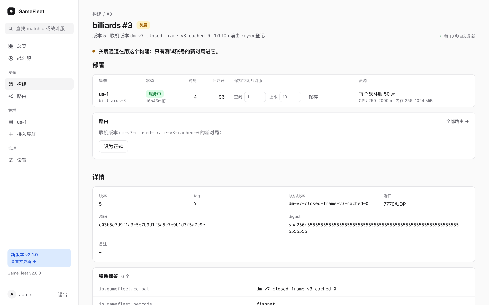
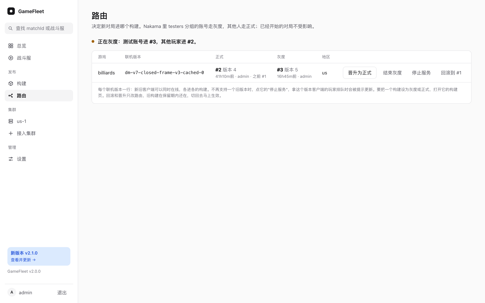

# 构建、部署和路由

| 词 | 意思 |
|---|---|
| 构建 | 推到 GameFleet 镜像仓库、登记过的一个战斗服镜像，编号 `#N` |
| 联机版本 | 镜像标签 `io.gamefleet.compat` 的值。只有联机版本相同的客户端能进这个构建的战斗服 |
| 部署 | 一个构建在一个集群里跑成的一组战斗服，也就是一个 Agones Fleet |
| 通道 | `stable`（正式，给所有玩家）和 `canary`（灰度，给测试玩家） |
| 路由 | "这个游戏、这个联机版本、这个通道的新对局进哪个构建" |

已经在打的对局不受路由影响，换版本只影响新对局。

## 推镜像、登记构建

**镜像的要求**（完整的约定见[战斗服约定](game-server.md)）：

| 标签 | 用途 |
|---|---|
| `io.gamefleet.compat` | 联机版本，1 到 128 个字母、数字、点、横线或下划线 |
| `org.opencontainers.image.revision` | 源码的 commit |
| `org.opencontainers.image.version` | 版本，控制台里显示为"版本"，比如 CI 的运行编号 |

镜像必须 `EXPOSE` 正好一个端口，比如 `7770/udp`。其他标签都会显示在构建页上。

**推送：** 在控制台"设置 → API key"里建一把 `push` 权限的 key。镜像仓库按 Docker 的习惯用户名随便填，密码就是 key。镜像仓库名就是游戏名，比如 `billiards`：

```sh
printf '%s' "$PUSH_KEY" | docker login fleet.example.com -u ci --password-stdin
docker tag 你的镜像 fleet.example.com/billiards:142
docker push fleet.example.com/billiards:142
```

**登记：** 推完调用一次接口，GameFleet 读出镜像的标签，给它一个构建号：

```sh
curl -sS --fail-with-body -X POST https://fleet.example.com/api/v1/builds \
  -H "Authorization: Bearer $PUSH_KEY" -H "Content-Type: application/json" \
  -d '{"repository": "billiards", "tag": "142", "note": "main a1b2c3d 修复进袋判定"}'
```

返回构建号、版本和联机版本。同一个镜像再登记一次，返回原来的构建。缺必填标签或端口不对时返回 `422 image_unusable`。

### 用 GitHub Actions

把 push key 存成一个 Environment 的 Secret，只给推镜像的 job 用。下面的例子里 Environment 叫 `gamefleet`，Secret 叫 `GAMEFLEET_PUSH_KEY`。每次推到 `main`，它构建镜像、推上去、登记成构建。改掉开头的三个值，在服务端构建好的那一步后面接上就能用：

```yaml
name: Game server
on:
  push:
    branches: [main]
permissions:
  contents: read
jobs:
  game-server:
    runs-on: ubuntu-latest
    environment: gamefleet
    env:
      GAMEFLEET: fleet.example.com  # GameFleet 的域名
      GAME: billiards               # 游戏名，也是镜像仓库名
      COMPAT: dm-v7                 # 联机版本：客户端和战斗服之间的协议一变就改它
      TAG: ${{ github.run_number }}
    steps:
      - uses: actions/checkout@v7
      # 这里先构建你的服务端。Dockerfile 里要 EXPOSE 正好一个端口
      - name: 构建镜像
        run: |
          docker build \
            --label io.gamefleet.compat="$COMPAT" \
            --label org.opencontainers.image.revision="$GITHUB_SHA" \
            --label org.opencontainers.image.version="$TAG" \
            -t "$GAMEFLEET/$GAME:$TAG" .
      - name: 推镜像、登记构建
        env:
          PUSH_KEY: ${{ secrets.GAMEFLEET_PUSH_KEY }}
          # 登录信息只写在这次运行的临时目录里，不留在 runner 上
          DOCKER_CONFIG: ${{ runner.temp }}/docker
        run: |
          set -euo pipefail
          printf '%s' "$PUSH_KEY" | docker login "$GAMEFLEET" -u ci --password-stdin
          docker push "$GAMEFLEET/$GAME:$TAG"
          jq -n --arg repository "$GAME" --arg tag "$TAG" --arg note "$GITHUB_REF_NAME ${GITHUB_SHA::8}" \
              '{repository: $repository, tag: $tag, note: $note}' |
            curl -sS --fail-with-body -X POST "https://$GAMEFLEET/api/v1/builds" \
              -H "Authorization: Bearer $PUSH_KEY" -H "Content-Type: application/json" --data-binary @-
```

标签用 `--label` 在构建时加上，Dockerfile 不用改。自己的 runner 上要有 Docker 和 `jq`。登记完的构建只出现在构建页上，部署和路由还是在控制台里做。

## 部署

打开构建页，在"部署到集群"里选集群，点"部署"。



几十秒后部署表里的空闲数到了设定值。设置：

- **每个战斗服最多几局：** 一个战斗服进程同时跑的对局数，默认 50。新的对局先填已经在跑的战斗服，满了才用空闲的。这也是一个进程崩溃时最多影响的局数。部署以后不能改。
- **空闲（保持空闲战斗服）：** 除了在跑对局的，再一直保持这么多个一局都没有的战斗服，默认 1。在跑对局的战斗服满了、空闲的开始用时，Agones 5 秒内补一个新的。
- **上限：** 这个部署最多开几个战斗服。全满又到了上限，新的分配会失败，返回 `no_capacity`。
- **CPU 和内存：** 每个战斗服申请的量和上限。K8s 按"申请"决定一台机器放得下几个战斗服。

已经 5 分钟没分到新对局、又一局都没有的战斗服，GameFleet 会删掉，只留"空闲"设的那几个。所以突发一批对局以后，多开的战斗服过几分钟自己就收回了。

## 路由和灰度

**第一次上线：** 构建部署好以后，在构建页点"设为正式"。

**发一个新版本：**

1. 部署新构建，在它的构建页点"设为灰度"。测试玩家的新对局进新构建，其他玩家不受影响。
2. 用测试账号试玩。测试玩家只和测试玩家配对。
3. 没问题就到"路由"页点"晋升为正式"。所有新对局都进新构建，灰度同时结束，测试玩家回到正式通道。旧构建开始排空：上面的对局照常打完，过了保留期（默认 24 小时）自动删掉。
4. 有问题就点"回滚到 #N"：正式通道指回上一个构建。旧构建还在保留期内的话马上生效。

谁是测试玩家由你的游戏后端决定：它调用分配接口时传 `"channel": "canary"` 还是 `"stable"`，见[接口](api.md#分配战斗服)。



**同一个联机版本最多一个灰度构建。** 灰度和正式指向同一个构建时没有意义，GameFleet 会自动删掉灰度路由。

**路由只能换到覆盖同样集群的构建。** 晋升、回滚和直接改路由都一样：原来的构建部署在 us-1 和 sg-1，新构建只部署在 us-1 时，GameFleet 不让切，因为切过去以后 sg 的玩家分不到战斗服。先把新构建部署到 sg-1 再切。灰度只在一个集群测没问题，晋升前补上其他集群就行。

## 新旧客户端同时在线

客户端不强制更新时，同一时间会有好几个联机版本的客户端在线。每个联机版本在"路由"页各占一行，各自指向和它兼容的构建：

- **只改了战斗服、联机版本没变：** 按上面的步骤发版，新构建替换旧构建。
- **改了联机版本（新客户端）：** 新构建会在路由页多出一行，旧版本那一行不动。新客户端进新构建，旧客户端照常进旧构建，两边互不配对。总览里每个构建下面写着它的联机版本。
- **不再支持旧客户端：** 在路由页旧版本那一行点"停止服务"。之后你的游戏后端为旧版本请求分配时，会得到 `404 route_not_found`，可以提示玩家更新；正在打的对局照常打完，旧构建开始排空。

## 部署的状态

| 状态 | 意思 |
|---|---|
| 待上线 | 部署了，还没有路由指向它；保持空闲战斗服 |
| 服务中 | 有路由指向它 |
| 排空中 | 没有路由再指向它，不再补空闲的战斗服；上面的对局照常打完 |
| 已删除 | 没有对局、过了保留期后自动删除，或者手动删除 |

路由指回一个排空中的部署（回滚），它马上恢复服务。GameFleet 的后台循环每 15 秒把集群调整到这个状态，所有改动都记进审计日志。

**手动删除排空中的部署，要等它停止接新局满一分钟。** 刚改完路由时，可能还有按旧路由发出的分配请求在路上，等一分钟能保证它们都落地或者失败了。删除是先记下来、再删集群里的 Fleet：这一步失败了，后台会在 Fleet 空了以后接着删。已删除的部署不能再被路由指向，要用这个构建就重新部署。

每个部署的 Fleet 名是"游戏名-构建号-四位随机字符"，比如 `billiards-12-k3x9`。同一个构建删了再部署，Fleet 名也不一样。数据库从备份恢复以后，构建号可能被重新用上，这时集群里留下的旧 Fleet 不会被认成新部署的，后台会把它当作残留，等它空了删掉。

## 运行时配置

战斗服运行时需要的设置（比如游戏后端的地址和密钥）放在"设置 → 运行时配置"里，GameFleet 把它们写进每个集群的 Secret `<游戏>-runtime`，战斗服启动时读成环境变量。改了以后，已经在跑的战斗服不变，之后新开的才用新值。战斗服什么设置都不需要的话，这里不用填。命令行也可以设，值从标准输入读，不会出现在命令行里：

```sh
cd /opt/gamefleet
printf '%s' "$VALUE" | docker compose exec -T gamefleet /gamefleet var billiards BACKEND_URL
```
